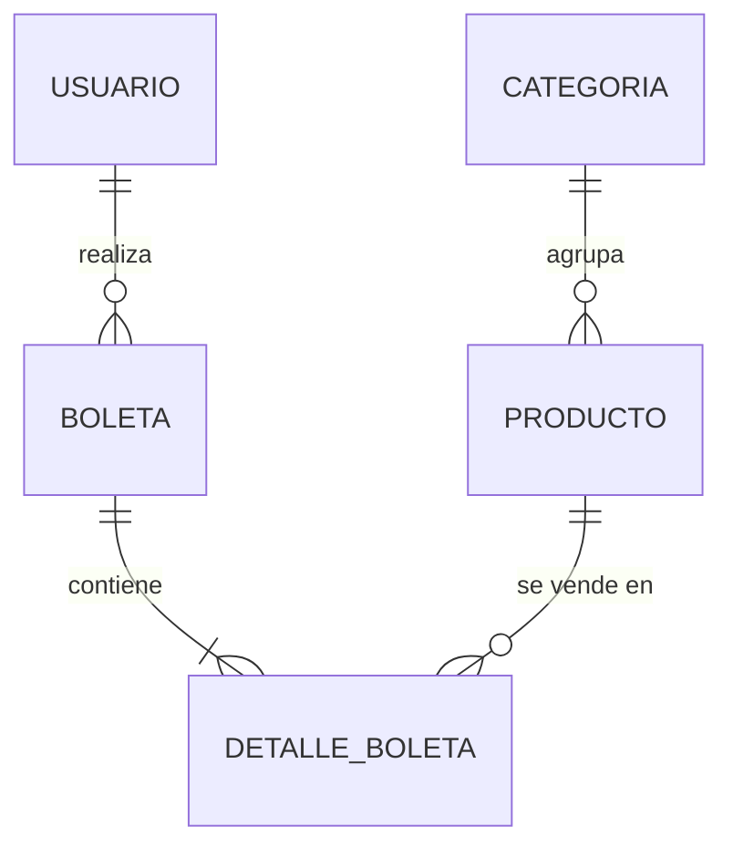

# Modelo de datos — AromaEsencial

Basado en la Figura 1 del enunciado: `USUARIO → BOLETA → DETALLE_BOLETA ← PRODUCTO ← CATEGORIA`.

## Tablas

### CATEGORIA
| Columna | Tipo | Restricciones |
|---|---|---|
| id | BIGINT | PK, autoincremental |
| nombre | VARCHAR(60) | NOT NULL, UNIQUE |
| descripcion | VARCHAR(255) | |

### PRODUCTO
| Columna | Tipo | Restricciones |
|---|---|---|
| id | BIGINT | PK, autoincremental |
| codigo | VARCHAR(20) | NOT NULL, UNIQUE (ej. `PF-016`) |
| nombre | VARCHAR(120) | NOT NULL |
| descripcion | VARCHAR(500) | |
| precio | INT | NOT NULL (CLP) |
| stock | INT | NOT NULL |
| stock_critico | INT | NOT NULL |
| imagen | VARCHAR(500) | URL |
| oferta | BOOLEAN | NOT NULL, por defecto false |
| categoria_id | BIGINT | FK → CATEGORIA, NOT NULL |

### USUARIO
| Columna | Tipo | Restricciones |
|---|---|---|
| id | BIGINT | PK, autoincremental |
| run | VARCHAR(12) | NOT NULL, UNIQUE |
| nombre, apellido | VARCHAR(60) | NOT NULL |
| correo | VARCHAR(120) | NOT NULL, UNIQUE |
| password | VARCHAR(100) | NOT NULL, hash BCrypt |
| telefono | VARCHAR(20) | |
| fecha_nacimiento | DATE | |
| region, comuna | VARCHAR(80) | |
| direccion | VARCHAR(200) | |
| rol | VARCHAR(20) | NOT NULL: `ADMINISTRADOR`, `VENDEDOR`, `CLIENTE` |
| activo | BOOLEAN | NOT NULL, por defecto true |

### BOLETA
| Columna | Tipo | Restricciones |
|---|---|---|
| id | BIGINT | PK, autoincremental |
| usuario_id | BIGINT | FK → USUARIO |
| fecha | DATETIME | NOT NULL |
| estado | VARCHAR(20) | NOT NULL: `CONFIRMADA`, `EN_PREPARACION`, `ENVIADA`, `ENTREGADA`, `CANCELADA` |
| subtotal, descuento, costo_envio, total | INT | NOT NULL |
| cupon | VARCHAR(30) | |
| metodo_pago, metodo_envio | VARCHAR | |
| direccion_envio, region, comuna, telefono | VARCHAR | copia (snapshot) de los datos de despacho |

### DETALLE_BOLETA
| Columna | Tipo | Restricciones |
|---|---|---|
| id | BIGINT | PK, autoincremental |
| boleta_id | BIGINT | FK → BOLETA, NOT NULL |
| producto_id | BIGINT | FK → PRODUCTO, NOT NULL |
| cantidad | INT | NOT NULL |
| precio_unitario | INT | NOT NULL (precio al momento de la compra) |
| subtotal | INT | NOT NULL |

## Equivalencias con el frontend actual (localStorage → BD)

| Frontend (JS) | Backend (Java / BD) |
|---|---|
| `producto.id` (slug `'dark-cedar'`) | `producto.id` numérico; el slug deja de existir |
| `producto.codigo` | `producto.codigo` |
| `producto.categoria` (texto) | `producto.categoria` (objeto `{id, nombre}`) |
| `rol: 'admin' / 'cliente'` | `rol: ADMINISTRADOR / VENDEDOR / CLIENTE` |
| `orden.estado: 'En preparación'` | `estado: EN_PREPARACION` (etiqueta en `EstadoBoleta.getEtiqueta()`) |
| `orden.productos[]` | `boleta.detalles[]` |
| `usuario.password` (texto plano) | `usuario.password` (hash BCrypt, nunca se devuelve) |

El frontend deberá convertir entre las etiquetas visibles y los valores del enum al llamar a la API.
